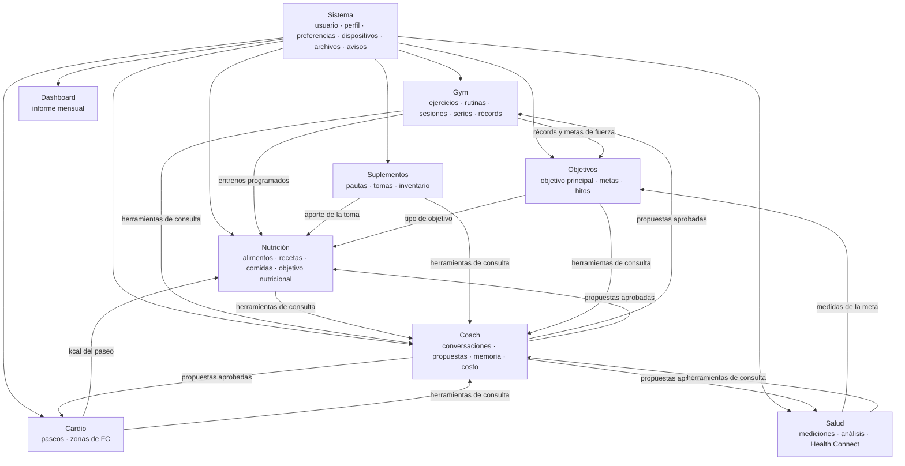
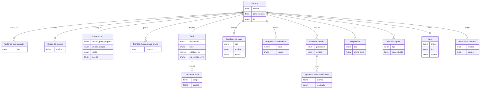
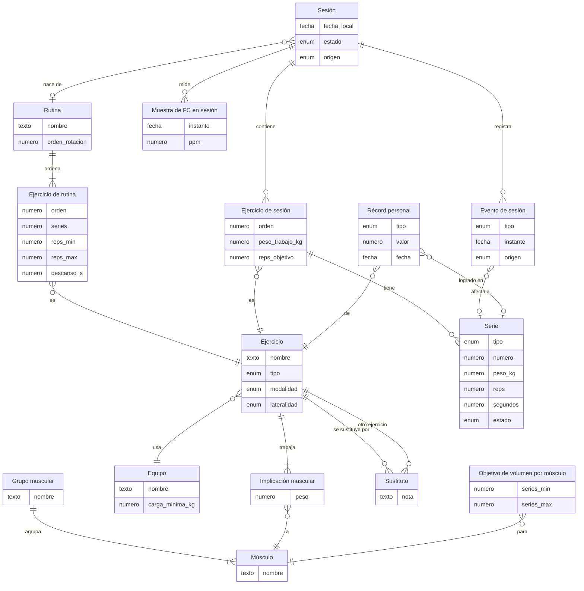
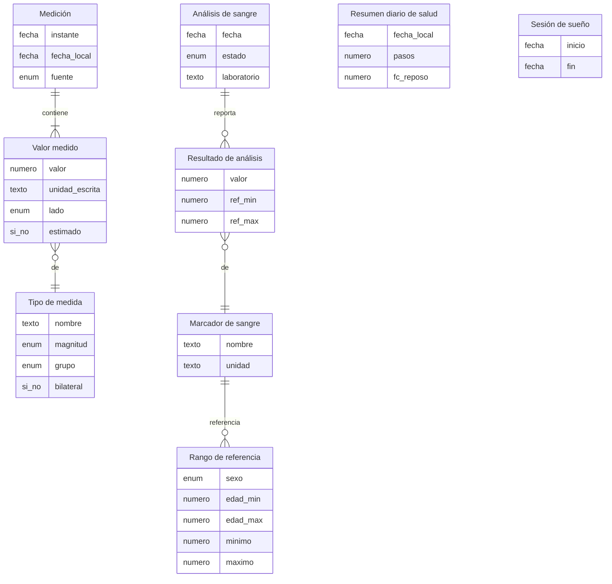
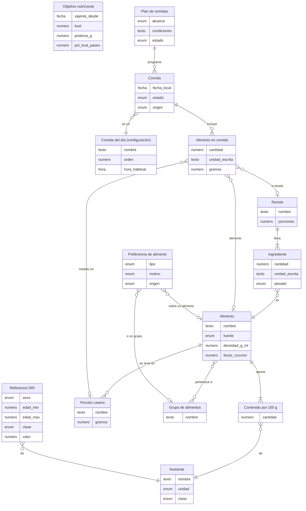
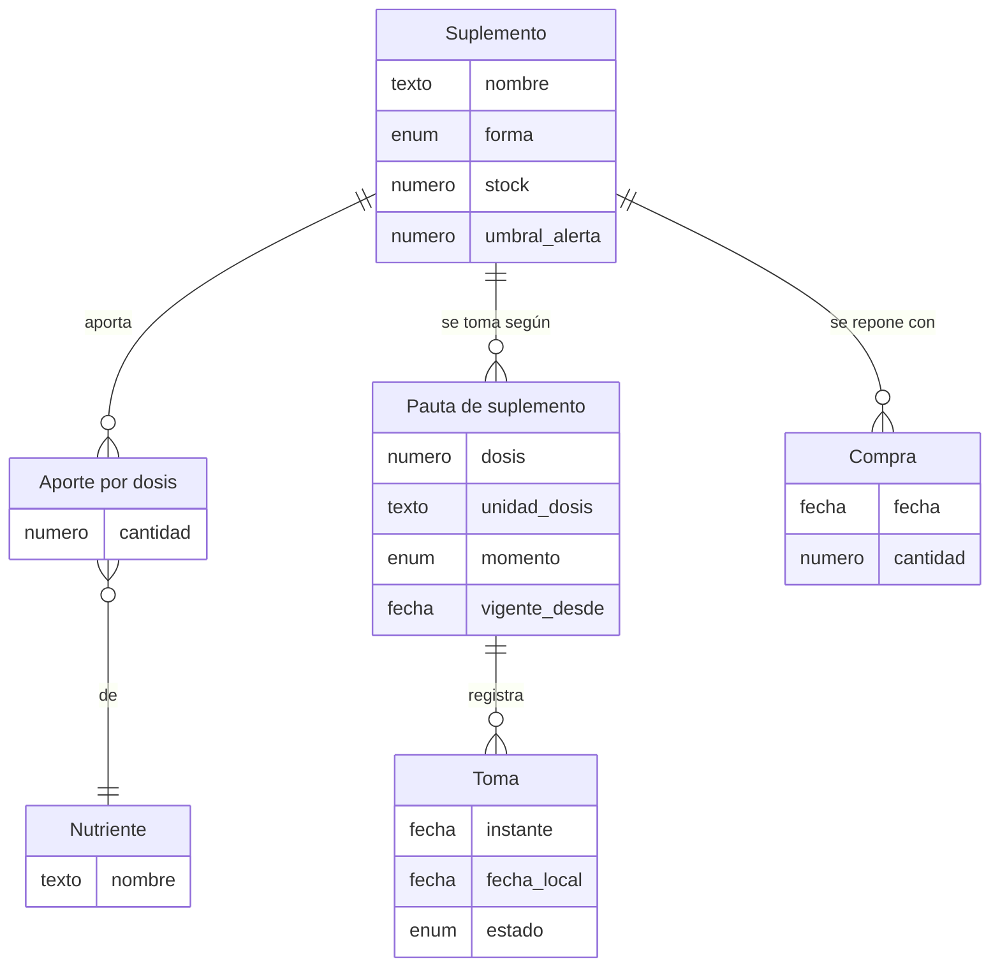
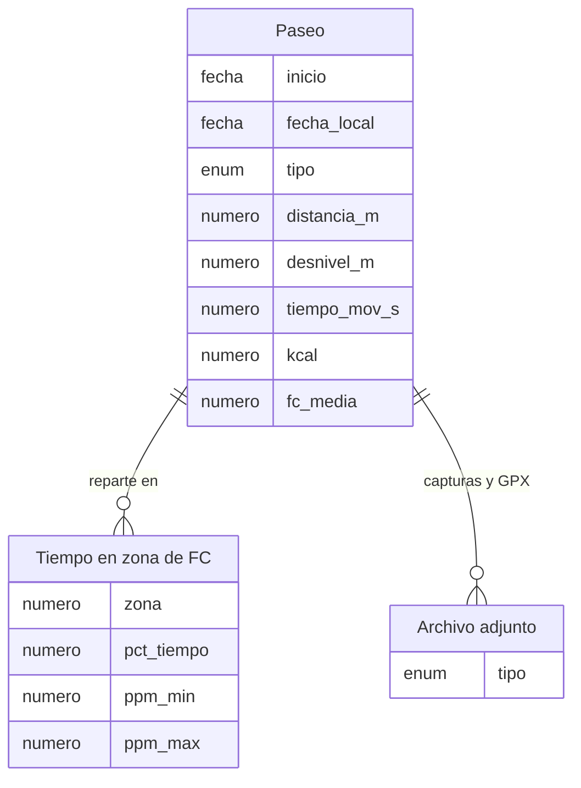
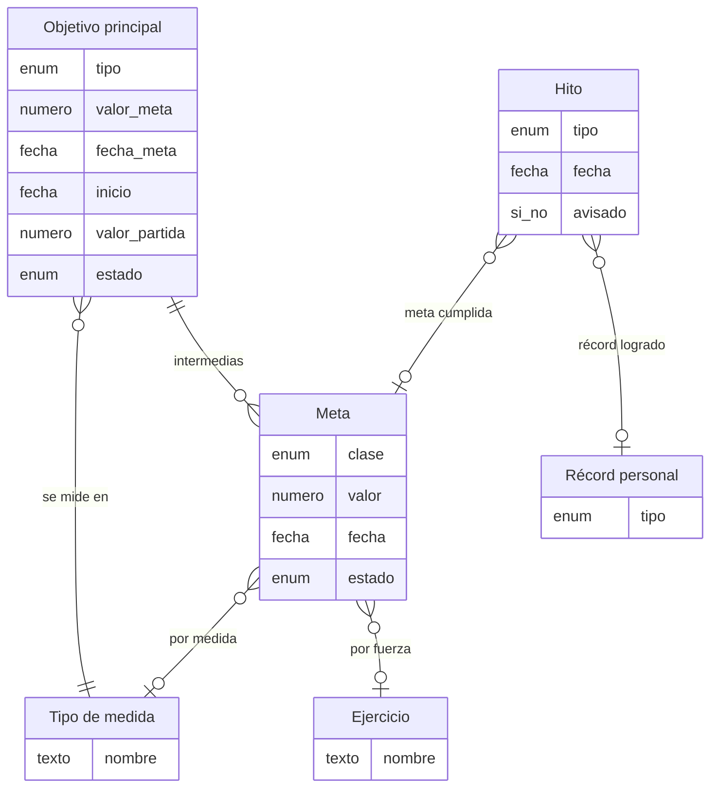
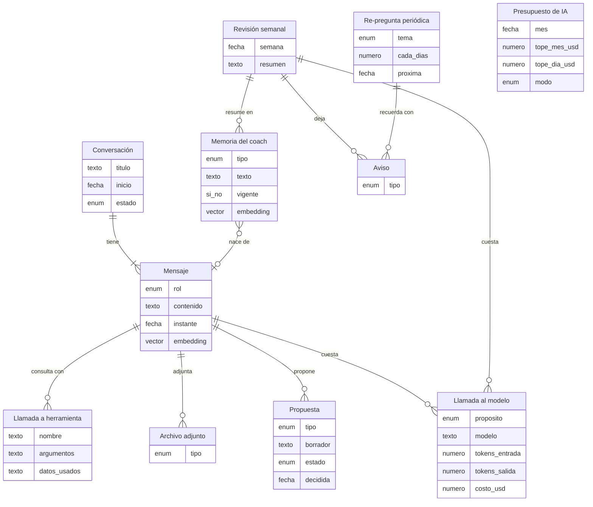

# Modelo conceptual de la base de datos

| Campo | Valor |
| --- | --- |
| Versión | 1.0 (borrador para aprobación) |
| Fecha | 18-oct-2026 |
| Estado | Pendiente de aprobación de Francis |
| Fase | 0.5 (ADR 0010, nivel 1 de 3) |
| Redacta | Arquitecto (Fable 5.1) |
| Fuentes | [`plan-maestro.md`](../plan-maestro.md) v1.14 (§5, §8, §10, Anexo A), [`prd.md`](../prd.md) v1.11, ADR [0004](../adr/0004-base-de-alimentos-y-unidades.md), [0005](../adr/0005-mtb-por-captura.md), [0006](../adr/0006-coach-con-herramientas-y-memoria.md), [0010](../adr/0010-diseno-de-base-de-datos-en-tres-niveles.md), [0012](../adr/0012-acceso-privado-y-multiusuario.md), [0013](../adr/0013-samsung-health-via-health-connect.md), [0018](../adr/0018-app-galaxy-watch-nativa.md), [0021](../adr/0021-embeddings-locales-en-el-servidor.md), [0023](../adr/0023-unidades-preferidas.md); mockups de los flujos 1, 2 y 10 |

Este documento dice **qué cosas guarda el sistema y cómo se relacionan**. No dice todavía con qué columnas, tipos ni índices: eso es el modelo lógico y físico de la Fase 1, que se escribe en `schema.dbml` y en el diccionario de datos a partir de lo que se apruebe aquí.

Cómo leerlo:

- Cada módulo tiene un diagrama y una tabla. En el diagrama, cada caja es una **entidad** (una cosa que se guarda) y cada línea una **relación**. Los extremos de la línea dicen cuántos: `||` exactamente uno, `o|` cero o uno, `|{` uno o más, `o{` cero o más. Debajo de cada caja van solo los dos o tres datos que la identifican; el resto está en la tabla.
- **Personal** quiere decir que la entidad pertenece a un usuario y lleva su `user_id` (ADR 0012). **Catálogo** quiere decir que es compartida por todos los usuarios (ejercicios de fábrica, nutrientes, tipos de medida) y no lleva usuario. Algunos catálogos admiten elementos **propios**: un ejercicio o un alimento creado por un usuario vive en la misma entidad, marcado con su dueño.
- Los nombres de las entidades están en español para esta revisión. La columna "nombre técnico" propone el nombre en inglés que usará la Fase 1 (CLAUDE.md: código en inglés).
- Lo que se **calcula** a partir de otras entidades (volumen por músculo, macros de una comida, medidas calculadas, día de comida) no es una entidad. Cada módulo lo lista al final para que nadie lo busque como tabla.

## 1. Mapa general

Ocho módulos funcionales sobre una sola base; el módulo Sistema sostiene a todos y el Coach lee todos.

## 2. Patrones que atraviesan todo el modelo

Estas reglas no se repiten en cada módulo; se asumen en todas las entidades personales.

| Patrón | Regla | De dónde sale |
| --- | --- | --- |
| **Multiusuario** | Toda entidad personal lleva `user_id`; ninguna consulta sin filtrarlo; RLS en Postgres como segunda barrera. Los catálogos no llevan usuario y son de solo lectura para los usuarios. | ADR 0012 |
| **Identidad y sincronización** | Toda entidad que se pueda crear en el teléfono o el reloj nace con un UUID generado en el cliente, la hora real en que ocurrió (reloj del dispositivo) y la hora en que el servidor la recibió. Reenviar el mismo UUID no duplica. Cada registro guarda qué dispositivo lo creó o lo cambió por última vez y una marca de versión; un borrado deja una lápida (`deleted_at`) para que los demás dispositivos lo sepan. | Plan §10 (offline-first), ADR 0018 |
| **Conflictos** | Gana el cambio más reciente por campo y el valor anterior queda en el **historial de cambios**. En series y eventos del gym gana siempre el teléfono. | Plan §10 |
| **Unidades** | Toda masa se guarda en kg, toda longitud corporal en cm y toda distancia en m. Cada valor escrito a mano guarda además la unidad en que se escribió (`entered_unit`). La comida se registra en g, kg, lb, oz, ml, L o porción casera y se convierte a gramos. | ADR 0023, ADR 0004 |
| **Fechas** | Lo que pertenece a un día (sesión, comida, toma, medición, paseo) guarda la **fecha local** del usuario además del instante exacto, para que el calendario y el desglose del día no dependan de la zona horaria del servidor. La zona horaria vive en el usuario. | ADR 0012 (configuración por usuario) |
| **Historial** | Lo que el usuario puede cambiar y el coach necesita en el tiempo (perfil, objetivo nutricional, objetivo principal, pautas de suplementos) no se sobrescribe: se cierra la fila vigente y se abre otra, o se anota el cambio en el historial. | SIS-09, COA-05, D-33 |
| **Archivos** | Capturas de Strava, fotos de etiquetas y el PDF del informe mensual se guardan en almacenamiento privado; la base guarda solo la referencia (**archivo adjunto**). | Plan §11 |
| **Catálogo más propios** | Ejercicios, alimentos, suplementos y tipos de medida tienen una parte de fábrica (sin dueño) y admiten elementos creados por el usuario (con dueño). Un elemento propio solo lo ve su dueño. | GYM-01, NUT-01, SAL-02 |
| **El coach solo propone** | Ninguna escritura del coach llega directo a las entidades de datos: pasa por una **propuesta** que el usuario aprueba, y al aprobarla se crean los registros reales con el origen anotado. | COA-04, ADR 0006 |

## 3. Sistema (SIS)

Cuenta, acceso, preferencias, perfil, bienvenida, conexiones externas, dispositivos, archivos y avisos.

| Entidad | Nombre técnico | Tipo | Qué guarda | Requisitos |
| --- | --- | --- | --- | --- |
| Usuario | `users` | personal (raíz) | Correo, nombre, contraseña (hash), rol (admin o usuario), zona horaria, idioma, fecha de alta, fecha de la primera actividad registrada (marca la semana 1 y la revisión cada 6 semanas; se fija una vez con la primera sesión o paseo). | SIS-01, D-26, D-33 |
| Factor de autenticación | `auth_factors` | personal | Segundo factor TOTP (secreto cifrado, verificado sí o no) y, más adelante, passkeys. Códigos de respaldo. | SIS-01, ADR 0012 |
| Sesión de acceso | `auth_sessions` | personal | Token de sesión o refresco, dispositivo, creada, expira, revocada. Una por inicio de sesión en cada dispositivo. | SIS-01 |
| Preferencias | `user_preferences` | personal (1 a 1) | Unidades (peso corporal, cargas, estatura, perímetros, distancia), modo (claro, oscuro, sistema), fondo, acento o color propio, lado de las medidas bilaterales (derecho de fábrica), formato de hora. | SIS-03, SIS-04, SIS-07, SAL-02 |
| Plantilla de apariencia propia | `appearance_templates` | personal | Nombre, modo, fondo y acento guardados por el usuario (las 8 de fábrica no se guardan, están en tokens.json). | SIS-04 |
| Perfil | `profiles` | personal (1 a 1) | Lo de la bienvenida que no es medición: nombre, fecha de nacimiento, sexo, estatura (copia de la última medición de estatura), experiencia en el gym, días por semana, duración y hora de la sesión, nivel de actividad diaria, frecuencia de MTB; y lo que se llena después: presupuesto, si cocina, sueño y estrés habituales, notas. Las preferencias de comida viven en Nutrición y los suplementos actuales en Suplementos. | SIS-08, SIS-09, D-32 a D-34 |
| Cambio de perfil | `profile_changes` | personal | Campo, valor anterior, valor nuevo, fecha y origen (usuario, re-pregunta del coach, bienvenida). Es el "historial con fecha" de SIS-09. | SIS-09, COA-05 |
| Condición de salud | `health_conditions` | personal | Lesión o molestia (rodilla, hombro, espalda baja, otra) o condición (presión alta, diabetes, asma, otra), con nombre, desde, hasta (vacío si sigue activa), notas y origen. Las alergias alimentarias no van aquí: son preferencias de alimento tipo "evitar" (NUT-11). | SIS-08 paso 4, COA-05 |
| Progreso de bienvenida | `onboarding_progress` | personal (0 a 1) | Paso alcanzado, respuestas en borrador de los pasos sin confirmar y estado (en curso, completada). Permite salir y retomar en otro dispositivo; al completar, lo escrito ya vive en perfil, preferencias, objetivo y mediciones. | SIS-08, D-32 |
| Conexión externa | `connections` | personal | Proveedor (Renpho, Health Connect, reloj), credenciales cifradas cuando aplica, estado (activa, con error, desconectada), último sync correcto. | SAL-01, SAL-06, WAT, SIS-08 paso 5 |
| Ejecución de sincronización | `sync_runs` | personal | Cada corrida de un sync externo: cuándo, resultado, cuántos registros, error. Sirve para avisar si Renpho falla 2 días. | SAL-01, PRD §8 |
| Dispositivo | `devices` | personal | Teléfono, reloj o navegador: identificador, nombre, plataforma, versión de la app, token de notificaciones, cursor de la última sincronización. Todo registro sincronizable apunta al dispositivo que lo creó. | GYM-10, WAT-05, WAT-06, plan §10 |
| Archivo adjunto | `attachments` | personal | Tipo (captura de Strava, foto de etiqueta, PDF de informe, GPX), ruta en almacenamiento privado, tamaño, fecha. Lo referencian el paseo, el alimento, el informe y el mensaje del chat. | CAR-01, NUT-12, DSH-02 |
| Aviso | `notifications` | personal | Lo que la app muestra en Hoy y en el panel web: origen (coach o sistema), tipo (consejo diario, alerta de tendencia, hito, récord, dosis olvidada, stock bajo, sync fallido, sesión cerrada sola, re-pregunta pendiente), texto, severidad, fecha, estado (nuevo, visto, descartado), referencia a lo que lo generó. | COA-03, OBJ-04, SUP-03, DSH-01 |
| Historial de cambios | `change_log` | personal | Auditoría de conflictos de sincronización y de ediciones sensibles: entidad, registro, campo, valor anterior, valor nuevo, dispositivo, fecha. | Plan §10, RNF-04 |

**Calculado, no guardado:** la semana en curso de cada usuario (desde la fecha de la primera actividad), la próxima revisión del plan (6 semanas), la edad.

## 4. Gym (GYM) y reloj (WAT)

El reloj no tiene entidades propias: produce eventos de sesión con origen "reloj" y, si WAT-04 entra, muestras de frecuencia cardiaca ligadas a la sesión.

| Entidad | Nombre técnico | Tipo | Qué guarda | Requisitos |
| --- | --- | --- | --- | --- |
| Grupo muscular | `muscle_groups` | catálogo | Pecho, espalda, hombros, brazos, piernas, glúteos, core. Decide "primer ejercicio de cada grupo" para la rampa y qué músculos ya están calientes. | GYM-05, D-29 |
| Músculo | `muscles` | catálogo | Músculo individual (pectoral mayor, deltoides anterior, deltoides posterior, tríceps, cuádriceps, femoral, glúteo mayor…), su grupo y el rango de series semanales de fábrica. | GYM-01, GYM-06 |
| Equipo | `equipment` | catálogo | Barra, mancuernas, máquina, polea, peso corporal, banda, kettlebell. Carga mínima (barra 45 lb, mancuerna 5 lb) y paso de disco de fábrica para el redondeo de la rampa. | GYM-01, D-30 |
| Ejercicio | `exercises` | catálogo + propios | Nombre, equipo, instrucciones, tipo (compuesto o aislamiento: decide si lleva rampa), modalidad (peso y reps, por tiempo, sin peso), lateralidad (bilateral, por lado), si cuenta las dos mancuernas en el volumen, dueño si es propio, activo. | GYM-01, GYM-05, D-30, D-31 |
| Implicación muscular | `exercise_muscles` | catálogo + propios | Ejercicio × músculo con peso de implicación (press banca: pectoral 1.0, deltoides anterior 0.5, tríceps 0.5). | GYM-01, GYM-06 |
| Sustituto | `exercise_substitutes` | catálogo | Ejercicio × ejercicio equivalente (dominadas asistidas ↔ jalón), con nota. | GYM-01 |
| Rutina | `routines` | personal | Nombre ("Día A · Push + Legs"), descripción, orden en la rotación (A, B, C), activa, origen (manual o propuesta del coach aprobada). La siguiente de la rotación es la que sigue a la última sesión hecha. | GYM-02, D-30 |
| Ejercicio de rutina | `routine_exercises` | personal | Ejercicio, orden, series (1 a 10), reps objetivo mínimo y máximo (1 a 30) o segundos si es por tiempo, descanso en segundos, rampa sí o no, potenciación sí o no, notas. | GYM-02, D-26, D-29 |
| Sesión | `workouts` | personal | Fecha local, estado (programada, en curso, hecha, no hecha, descartada), origen (rutina, vacía, copia de otra sesión, movida, propuesta del coach), rutina de la que nació (opcional; editarla no cambia la rutina), inicio, fin, si se cerró sola tras 2 h, tiempos totales (total, en series, descanso programado, extra), notas, dispositivo. Varias sesiones el mismo día están permitidas. | GYM-03, GYM-04, GYM-09, GYM-10, D-25, D-31 |
| Ejercicio de sesión | `workout_exercises` | personal | Ejercicio, orden, peso de trabajo (kg y unidad escrita; por mancuerna si aplica), reps objetivo, series previstas, descanso, rampa y potenciación aplicadas, tiempos del ejercicio. Es lo que se confirma en los pasos 2 y 3 al programar y lo que cambia un ajuste al vuelo. | GYM-03, GYM-04, D-26, D-30 |
| Serie | `sets` | personal | Tipo (rampa, tanteo, trabajo, potenciación), número, previsto (peso, reps o segundos), real (peso, reps o segundos), estado (pendiente, hecha, saltada), inicio y fin, descanso programado y tiempo extra reales, unidad escrita. La rampa no cuenta para el volumen. | GYM-04, GYM-05, GYM-09, D-31 |
| Evento de sesión | `workout_events` | personal | Registro con hora real de cada acción: iniciar, play, check, saltar serie, ajustar peso o reps, +15 s, −15 s, saltar descanso, pausar, minimizar, finalizar, cierre automático. Origen (teléfono, reloj, web), UUID del cliente. Con los eventos se recalculan los tiempos y se recupera una sesión interrumpida. | GYM-09, GYM-10, WAT-02, WAT-06, ADR 0018 |
| Muestra de FC en sesión | `workout_heart_rate_samples` | personal | Instante y pulsaciones por minuto tomadas por el reloj durante la sesión (WAT-04, S). | WAT-04 |
| Récord personal | `personal_records` | personal | Ejercicio, tipo (1RM estimado, 3RM, 5RM, 8RM, 10RM, peso máximo, reps máximas, volumen máximo), valor, fecha, serie en que se logró, sesión. Se guarda para disparar el hito y mostrarlo en el resumen. | GYM-07, OBJ-04 |
| Objetivo de volumen por músculo | `muscle_volume_targets` | personal | Músculo, series semanales mínimas y máximas. Nace con los valores de fábrica del músculo; el coach puede proponer cambios. | GYM-06 |

**Calculado, no guardado:** las series rampa (se generan al programar desde el peso de trabajo y las reps objetivo; una vez generadas sí se guardan como series de tipo rampa), el volumen semanal por músculo (series de trabajo × implicación), el volumen en carga de la sesión (con las dos mancuernas y los dos lados), el 1RM estimado de cada serie (se guarda solo el récord), "no hecha" (programada con fecha pasada y sin iniciar), la siguiente rutina de la rotación.

## 5. Salud (SAL)

| Entidad | Nombre técnico | Tipo | Qué guarda | Requisitos |
| --- | --- | --- | --- | --- |
| Tipo de medida | `measurement_types` | catálogo + propios | Cada cosa que se puede medir del cuerpo: peso, % de grasa, grasa subcutánea, grasa visceral, músculo esquelético, masa muscular, agua, proteína, masa ósea, TMB, edad metabólica, peso sin grasa (todo lo de Renpho); estatura, cintura, cuello, hombros, pecho, cadera, brazo relajado, brazo contraído, muslo, pantorrilla, antebrazo, muñeca, tobillo, abdomen bajo; pliegues (7 sitios); FC en reposo; presión sistólica y diastólica; y los calculados (IMC, cintura/estatura, cintura/cadera, hombros/cintura, % de grasa Marina). Magnitud (masa, longitud, porcentaje, índice, presión, frecuencia, kcal, años), unidad canónica, grupo (obligatoria, recomendada, opcional, automática, calculada), si es bilateral, frecuencia sugerida, propio del usuario si lo creó él. | SAL-01, SAL-02, SAL-07, D-24 |
| Medición | `measurements` | personal | Un momento de medir: instante real, fecha local, fuente (Renpho, manual, Health Connect, bienvenida, re-pregunta del coach, calculada), conexión que la trajo, notas. Una lectura de Renpho es una medición con una docena de valores; una sesión de cinta es otra. | SAL-01, SAL-02, SIS-08 paso 6 |
| Valor medido | `measurement_values` | personal | Medición × tipo de medida: valor en unidad canónica, unidad escrita, lado (derecho, izquierdo, ninguno), estimado sí o no. | SAL-02, ADR 0023 |
| Marcador de sangre | `blood_markers` | catálogo | Glucosa, HbA1c, colesterol total, HDL, LDL, triglicéridos, testosterona, TSH, ferritina, vitamina D, hemograma básico, etc.: nombre, unidad, descripción en lenguaje claro. | SAL-04 |
| Rango de referencia | `marker_reference_ranges` | catálogo | Por marcador, sexo y rango de edad: mínimo y máximo de referencia. El laboratorio puede traer el suyo en el resultado. | SAL-04 |
| Análisis de sangre | `blood_tests` | personal | Fecha, estado (programado, hecho), laboratorio, preparación (ayuno, qué suspender), recordatorio, archivo del informe, notas. La cita del calendario de Gym es un análisis en estado programado; al cargar los resultados pasa a hecho. | SAL-04, D-25 |
| Resultado de análisis | `blood_results` | personal | Análisis × marcador: valor, unidad, rango del laboratorio si vino, fuera de rango sí o no. | SAL-04 |
| Resumen diario de salud | `daily_health_summaries` | personal | Por fecha local, lo que trae Health Connect: pasos, FC en reposo, FC media, mínima y máxima, origen. Una fila por día; se actualiza cuando la app sincroniza. | SAL-06 |
| Sesión de sueño | `sleep_sessions` | personal | Inicio, fin, duración, fases si Health Connect las da, origen. | SAL-06 |

**Calculado, no guardado:** las medidas calculadas de SAL-07 se recalculan al guardar una medición y se escriben como una medición de fuente "calculada" (ver decisión 2), así tienen tendencia y pueden ser meta; la media de 7 días y la tendencia de 4 semanas del peso; qué dato falta para cada medida calculada.

## 6. Nutrición (NUT)

| Entidad | Nombre técnico | Tipo | Qué guarda | Requisitos |
| --- | --- | --- | --- | --- |
| Nutriente | `nutrients` | catálogo | Energía, proteína, carbohidratos, grasa, fibra, azúcares, azúcar añadida, grasa saturada, sodio, potasio, calcio, hierro, magnesio, zinc, vitaminas…: nombre, unidad (kcal, g, mg, µg), clase (macro, micro, límite), orden en el desglose. | NUT-01, NUT-03 |
| Alimento | `foods` | catálogo + propios | Nombre local, marca, fuente (USDA, INCAP, Open Food Facts, manual, etiqueta), identificador en la fuente, densidad g/ml (y si es estimada), estado (crudo, cocido, listo) y factor de cocción por defecto, grupo(s), foto de etiqueta (archivo), dueño si es propio, verificado, activo. | NUT-01, NUT-12, ADR 0004 |
| Contenido por 100 g | `food_nutrients` | catálogo + propios | Alimento × nutriente: cantidad por 100 g. | NUT-01 |
| Porción casera | `food_portions` | catálogo + propios | Taza, cucharada, unidad, cucharón, rebanada, "porción de la etiqueta": nombre y gramos para ese alimento. | NUT-02, NUT-12 |
| Grupo de alimentos | `food_groups` | catálogo | Lácteos, gluten, maní, frutos secos, mariscos, huevo, soya, pescado, carnes, cereales, frutas…: sirve para las alergias de la bienvenida y para buscar. | NUT-11, SIS-08 paso 4 |
| Receta | `recipes` | personal | Nombre, porciones que rinde, peso total cocido (opcional), notas, origen (manual o propuesta del coach). Una receta de 1 porción es un combo. | NUT-04 |
| Ingrediente | `recipe_ingredients` | personal | Alimento, cantidad, unidad escrita, gramos, pesado crudo o cocido (aplica el factor del alimento). | NUT-04 |
| Comida del día (configuración) | `meal_slots` | personal | Las comidas que el usuario tiene (desayuno, merienda, almuerzo, merienda, cena de fábrica): nombre, orden, hora habitual, activa. Se cambia en Ajustes. | NUT-02 |
| Comida | `meals` | personal | Fecha local, comida del día a la que pertenece, estado (programada, comida), hora real, origen (manual, copia de otro día, copia de la semana, plan del coach, "lo comí" de una programada), plan al que pertenece, notas. Solo las comidas en estado "comida" cuentan. | NUT-02, NUT-10, NUT-05 |
| Alimento en comida | `meal_items` | personal | Alimento **o** receta, cantidad, unidad escrita (g, kg, lb, oz, ml, L o porción casera), gramos calculados, porciones si es receta, pesado crudo o cocido, orden. | NUT-02, NUT-04, NUT-09 |
| Preferencia de alimento | `food_preferences` | personal | Alimento **o** grupo, tipo (preferido, evitar), motivo (gusto, alergia, intolerancia, alcance local), origen (bienvenida, manual, despensa precargada), notas. | NUT-11, D-35 |
| Objetivo nutricional | `nutrition_targets` | personal | Vigente desde y hasta, kcal del día, proteína, carbohidratos, grasa, porcentaje de las kcal del paseo que suma al día (50 % de fábrica), cómo se calculó (Katch-McArdle o Mifflin-St Jeor, nivel de actividad, ajuste por objetivo), origen (bienvenida, revisión de 6 semanas, propuesta del coach, manual). Cada revisión abre una fila nueva. | NUT-03, D-27, D-32 a D-34 |
| Referencia DRI | `dri_references` | catálogo | Nutriente × sexo × rango de edad: valor y clase (objetivo o límite). Sodio 2,300 mg, azúcar añadida y grasa saturada como límite. | NUT-03 |
| Plan de comidas | `meal_plans` | personal | Pedido al coach: alcance (día, semana, mes), fechas, condiciones del pedido, estado (propuesto, aprobado completo, aprobado parcial, rechazado), propuesta de la que salió. Las comidas aprobadas quedan en el calendario apuntando al plan. | NUT-05, D-35 |

**Calculado, no guardado:** kcal y macros de cada comida y del día (gramos × contenido por 100 g); nutrientes de una receta (desde sus ingredientes) y de una porción de receta; el objetivo del día (objetivo vigente + porcentaje de las kcal del paseo de ese día); fibra objetivo (14 g por 1,000 kcal); columnas Total, Objetivo y Restan; alimentos frecuentes y recientes con su porción habitual (desde el historial de "alimento en comida"); lo que el coach lee de una etiqueta antes de confirmarse (vive en la propuesta).

## 7. Suplementos (SUP)

| Entidad | Nombre técnico | Tipo | Qué guarda | Requisitos |
| --- | --- | --- | --- | --- |
| Suplemento | `supplements` | catálogo + propios | Nombre (whey, creatina, vitamina D3, omega-3, magnesio, zinc, cafeína), forma (polvo, cápsula, tableta, líquido), unidad de dosis (g, mg, UI, cápsula), stock actual y umbral de alerta (SUP-03), notas, dueño si es propio. | SUP-01, SUP-03 |
| Aporte por dosis | `supplement_nutrients` | catálogo + propios | Suplemento × nutriente: cantidad por unidad de dosis. Usa el mismo catálogo de nutrientes que los alimentos. | SUP-02 |
| Pauta de suplemento | `supplement_regimens` | personal | Suplemento, dosis, momento (desayuno, pre-entreno, post-entreno, con comidas, antes de dormir, hora fija), días de la semana, vigente desde y hasta, activa, origen. Las pautas activas son los "suplementos actuales" del perfil. | SUP-01, SIS-09 |
| Toma | `supplement_intakes` | personal | Pauta, instante, fecha local, dosis real, estado (tomada, saltada), dispositivo. Suma su aporte al día. | SUP-02 |
| Compra | `supplement_purchases` | personal | Suplemento, fecha, cantidad comprada, precio, tienda. Sube el stock; cada toma lo baja. | SUP-03 |

**Calculado, no guardado:** dosis pendientes del día (pautas activas sin toma), aporte del día (tomas × aporte por dosis), alerta de stock bajo y de dosis olvidada (se escriben como avisos cuando se disparan).

## 8. Cardio (CAR)

| Entidad | Nombre técnico | Tipo | Qué guarda | Requisitos |
| --- | --- | --- | --- | --- |
| Paseo | `cardio_activities` | personal | Tipo (MTB de fábrica; caminata u otro para después), inicio, fecha local, distancia en m, desnivel positivo en m, tiempo en movimiento y total, kcal, FC media y máxima, unidad escrita de la distancia, fuente (captura de Strava, manual), propuesta de la que salió, confirmado, notas. | CAR-01, D-27 |
| Tiempo en zona de FC | `cardio_hr_zones` | personal | Paseo × zona (1 a 5): % del tiempo y rango en ppm. Cinco filas por paseo. | CAR-01, D-27 |

**Calculado, no guardado:** velocidad media (distancia / tiempo en movimiento), kcal que suben el objetivo del día (porcentaje del objetivo nutricional), carga combinada gym + MTB y su efecto en recuperación (lo juzga el coach con las herramientas).

## 9. Objetivos (OBJ)

| Entidad | Nombre técnico | Tipo | Qué guarda | Requisitos |
| --- | --- | --- | --- | --- |
| Objetivo principal | `goals` | personal | Tipo (perder grasa, ganar músculo, recomposición, fuerza, salud general, rendimiento MTB), medida de la meta (un tipo de medida: peso, % de grasa, cintura u otra), valor meta, fecha meta, fecha de inicio, valor de partida (media de 7 días al inicio), estado (activo, cumplido, reemplazado, abandonado), fecha de cierre. Uno activo a la vez; los anteriores son el historial. | OBJ-01, D-28, D-34 |
| Meta | `targets` | personal | Clase (intermedia, por medida, por fuerza). Intermedia: pertenece al objetivo principal, fecha y valor propuestos en línea recta cada 4 semanas, editables. Por medida: tipo de medida y valor. Por fuerza: ejercicio, carga o repeticiones, valor en kg más unidad escrita. Todas: origen (propuesta por la app, editada, propuesta del coach), estado (vigente, cumplida, vencida, borrada), fecha de cumplimiento. | OBJ-02, OBJ-03, D-28 |
| Hito | `milestones` | personal | Tipo (meta intermedia, meta por medida, meta por fuerza, récord personal), fecha, meta o récord que lo originó, avisado sí o no. | OBJ-04 |

**Calculado, no guardado:** estado de cada meta intermedia (adelante, en ritmo, atrasado) con la media de 7 días y la tendencia de 4 semanas; la propuesta inicial de metas intermedias (se guardan una vez aceptadas); la línea punteada de los gráficos.

## 10. Coach (COA)

| Entidad | Nombre técnico | Tipo | Qué guarda | Requisitos |
| --- | --- | --- | --- | --- |
| Conversación | `conversations` | personal | Título, inicio, última actividad, estado (abierta, archivada), modelo con el que empezó, tokens y costo acumulados. | COA-01 |
| Mensaje | `messages` | personal | Rol (usuario, coach, sistema), contenido, instante, modelo, tokens, estado (enviado, en cola sin conexión, fallido), embedding para la búsqueda semántica (ADR 0021). | COA-01, COA-02 |
| Llamada a herramienta | `tool_calls` | personal | Mensaje, nombre de la herramienta, argumentos, resultado resumido y qué datos usó (rango de fechas, entidades), duración. Es lo que permite al coach "decir qué datos usó" y a la tarjeta decir "Revisando tus sesiones…". | COA-01, O3 |
| Propuesta | `proposals` | personal | Toda escritura del coach: tipo (rutina, sesión, plan de comidas, comida, receta, objetivo nutricional, paseo desde captura, alimento desde etiqueta, cambio de perfil o de medidas por re-pregunta), borrador estructurado, mensaje de origen, estado (pendiente, aprobada, aprobada en parte, rechazada, caducada), fecha de decisión, registros creados al aprobar. | COA-04, NUT-05, NUT-12, CAR-01, COA-05 |
| Memoria del coach | `coach_memories` | personal | Tipo (decisión, preferencia, hecho, resumen semanal), texto ("mantener face pull"), fecha, origen (mensaje, revisión, manual), vigente, embedding. | COA-02, ADR 0006, ADR 0021 |
| Revisión semanal | `weekly_reviews` | personal | Semana, resumen, hallazgos, métricas de la semana en el momento de la revisión, estado, avisos y memorias que generó. La corre el job semanal. | COA-03 |
| Re-pregunta periódica | `periodic_questions` | personal | Tema (cinta, actividad, salud y lesiones), cada cuántos días (28 o 90), última respuesta, próxima fecha, activa. La respuesta llega como propuesta que actualiza perfil, condiciones o mediciones. | COA-05 |
| Llamada al modelo | `model_calls` | personal | Cada uso de la API: propósito (chat, consejo diario, revisión semanal, plan, etiqueta, captura, informe, eval), modelo, tokens de entrada, salida, caché leída y escrita, costo, duración, conversación o mensaje si aplica, fecha. | RNF-11, PRD §6 |
| Presupuesto de IA | `ai_budgets` | personal | Mes, tope mensual ($80) y diario ($8), gasto acumulado (calculado desde las llamadas, cacheado), modo (normal, degradado a Sonnet al 80 %, detenido), avisado. | PRD §6, RNF-11 |

**Calculado, no guardado:** el contexto fijo del coach (perfil, etapa, objetivo, metas vigentes y reglas) se arma en cada llamada desde las entidades; los consejos diarios se guardan como avisos, no como mensajes; las evals viven en el repositorio, no en la base.

## 11. Dashboard (DSH)

El panel del día no guarda nada propio: lee sesión de hoy, comidas, tomas pendientes, última medición, avisos y objetivo. Solo el informe mensual deja huella.

| Entidad | Nombre técnico | Tipo | Qué guarda | Requisitos |
| --- | --- | --- | --- | --- |
| Informe mensual | `monthly_reports` | personal | Mes, generado el, texto del coach, archivo PDF, estado (generando, listo, fallido), llamada al modelo que lo escribió. | DSH-02 |

## 12. Relaciones entre módulos

| Desde | Hacia | Relación |
| --- | --- | --- |
| Objetivo principal y meta por medida (OBJ) | Tipo de medida (SAL) | La meta se mide en un tipo de medida; su progreso se lee en los valores medidos |
| Meta por fuerza (OBJ) | Ejercicio (GYM) | La meta apunta a un ejercicio; el récord personal la cumple |
| Hito (OBJ) | Récord personal (GYM) | Un récord nuevo genera un hito |
| Paseo (CAR) | Objetivo nutricional (NUT) | El día del paseo, el objetivo de kcal sube con el porcentaje configurado |
| Sesión programada (GYM) | Plan de comidas (NUT) | El coach reparte carbohidratos alrededor de los entrenos programados |
| Toma (SUP) | Desglose del día (NUT) | El aporte por dosis se suma en una fila propia "Suplementos", fuera de las comidas |
| Objetivo principal (OBJ) y perfil (SIS) | Objetivo nutricional (NUT) | Tipo de objetivo, % de grasa, peso y actividad fijan kcal y proteína (paso 7 de la bienvenida y cada revisión) |
| Preferencia de alimento (NUT) | Bienvenida (SIS) | Las alergias del paso 4 se guardan como preferencias "evitar" sobre un grupo |
| Propuesta (COA) | Rutina, sesión, comida, plan, receta, paseo, alimento, perfil, medición | Al aprobar, se crean los registros reales con origen "propuesta" y la propuesta guarda sus identificadores |
| Aviso (SIS) | Revisión semanal, re-pregunta, hito, récord, pauta, conexión, sesión | Cada aviso apunta a lo que lo generó |
| Archivo adjunto (SIS) | Paseo, alimento, mensaje, análisis, informe | Un archivo pertenece a un solo registro |
| Dispositivo (SIS) | Todo registro sincronizable | Dispositivo que lo creó o cambió por última vez |
| Análisis de sangre (SAL) y paseo (CAR) | Calendario de Gym | Se muestran por fecha; no hay entidad "calendario" |

## 13. Trazabilidad: requisito → entidades

| Requisito | Entidades |
| --- | --- |
| GYM-01 | Ejercicio, Equipo, Músculo, Grupo muscular, Implicación muscular, Sustituto |
| GYM-02 | Rutina, Ejercicio de rutina |
| GYM-03 | Sesión, Ejercicio de sesión, Serie, Paseo, Análisis de sangre |
| GYM-04, GYM-05 | Sesión, Ejercicio de sesión, Serie, Evento de sesión, Equipo (paso de disco) |
| GYM-06 | Serie, Implicación muscular, Objetivo de volumen por músculo |
| GYM-07 | Récord personal, Serie |
| GYM-09, GYM-10 | Evento de sesión, Sesión, Dispositivo |
| WAT-01, 02, 05, 06 | Evento de sesión (origen reloj), Dispositivo, Conexión externa |
| WAT-03 | Evento de sesión (ajuste), Ejercicio de sesión |
| WAT-04 | Muestra de FC en sesión |
| SAL-01 | Conexión externa, Ejecución de sincronización, Medición, Valor medido |
| SAL-02, SAL-07 | Tipo de medida, Medición, Valor medido, Preferencias (lado) |
| SAL-04 | Análisis de sangre, Resultado de análisis, Marcador de sangre, Rango de referencia, Archivo adjunto |
| SAL-06 | Resumen diario de salud, Sesión de sueño, Conexión externa |
| NUT-01 | Alimento, Nutriente, Contenido por 100 g, Porción casera, Grupo de alimentos |
| NUT-02, NUT-09 | Comida del día (configuración), Comida, Alimento en comida |
| NUT-03 | Objetivo nutricional, Referencia DRI, Nutriente |
| NUT-04 | Receta, Ingrediente |
| NUT-05 | Plan de comidas, Propuesta, Comida |
| NUT-10 | Comida (estado programada, origen copia) |
| NUT-11 | Preferencia de alimento, Grupo de alimentos |
| NUT-12 | Alimento (fuente etiqueta), Porción casera, Archivo adjunto, Propuesta, Llamada al modelo |
| SUP-01, 02, 03 | Suplemento, Aporte por dosis, Pauta de suplemento, Toma, Compra, Aviso |
| CAR-01, CAR-02 | Paseo, Tiempo en zona de FC, Archivo adjunto, Propuesta, Objetivo nutricional |
| COA-01 | Conversación, Mensaje, Llamada a herramienta, Llamada al modelo |
| COA-02 | Memoria del coach, Mensaje (embedding) |
| COA-03 | Revisión semanal, Aviso |
| COA-04 | Propuesta |
| COA-05 | Re-pregunta periódica, Propuesta, Cambio de perfil, Condición de salud, Medición |
| DSH-01 | (lectura de todo) Aviso |
| DSH-02 | Informe mensual, Archivo adjunto |
| OBJ-01 a 04 | Objetivo principal, Meta, Hito, Récord personal, Tipo de medida, Ejercicio |
| SIS-01 | Usuario, Factor de autenticación, Sesión de acceso |
| SIS-02 | (exporta todas las entidades personales) |
| SIS-03, SIS-04 | Preferencias, Plantilla de apariencia propia |
| SIS-05 | (archivo de marca en el repo, no en la base) |
| SIS-06 | (MDX en el repo, no en la base) |
| SIS-07 | Preferencias, `entered_unit` en cada valor escrito |
| SIS-08 | Progreso de bienvenida, Perfil, Preferencias, Objetivo principal, Meta, Condición de salud, Preferencia de alimento, Medición, Conexión externa, Objetivo nutricional |
| SIS-09 | Perfil, Cambio de perfil, Condición de salud, Preferencia de alimento, Pauta de suplemento |
| RNF-03, RNF-04 | UUID de cliente, Dispositivo, Evento de sesión, Historial de cambios, lápidas |
| RNF-11 | Llamada al modelo, Presupuesto de IA |

Total: 73 entidades (9 de catálogo, 8 de catálogo con propios, 56 personales).

## 14. Decisiones que tomé y necesito que confirmes

1. **Mediciones como tipos de medida más valores, no como una tabla ancha.** Una medición (un momento, una fuente) tiene muchos valores, cada uno de un tipo del catálogo. Así "cualquier otra métrica" (SAL-02) es solo un tipo nuevo, Renpho y la cinta comparten la misma estructura, y una meta por medida (OBJ-03) puede apuntar a cualquiera, incluidas las calculadas. El costo es que las consultas de "peso en el tiempo" filtran por tipo en vez de leer una columna; se resuelve con índices en la Fase 1.
2. **Las medidas calculadas (SAL-07) se guardan.** Cada vez que entra una medición, la app recalcula IMC, índices y % de grasa Marina y los guarda como una medición de fuente "calculada". Ventaja: tienen tendencia en los gráficos y sirven de meta (el PRD ya pone cintura/altura ≤ 0.51 como meta). Alternativa: calcularlas al vuelo cada vez, más simple pero sin historial ni meta.
3. **Alergias y lista de evitar sobre grupos de alimentos.** Los chips de la bienvenida (lactosa, gluten, maní) son grupos; una preferencia "evitar" apunta a un grupo o a un alimento concreto. Para que "el coach nunca propone un alimento de evitar" se pueda comprobar con datos, cada alimento del catálogo lleva sus grupos. "Otra" en la bienvenida crea una preferencia sobre un grupo nuevo con el texto escrito.
4. **Lesiones y condiciones como entidad propia con vigencia**, no como texto en el perfil. Cada una tiene desde y hasta, y las re-preguntas cada 3 meses las cierran o abren sin perder el historial.
5. **Una sola puerta de escritura del coach: la propuesta.** Rutinas, sesiones, planes y comidas, recetas, el paseo leído de la captura, el alimento leído de la etiqueta, el ajuste del objetivo nutricional y las respuestas a re-preguntas pasan por la misma entidad con el mismo ciclo (pendiente → aprobada, en parte o rechazada). La tarjeta de confirmación del paseo y el formulario casi lleno de la etiqueta son propuestas en pantalla.
6. **La sesión guarda estado y eventos.** Las series tienen su estado materializado (lo que se ve y se consulta) y además existe el registro de eventos con hora real. Para recuperar una sesión interrumpida o resolver un conflicto reloj-teléfono manda el evento; los tiempos de GYM-09 se calculan desde los eventos.
7. **Rutina con orden de rotación, sin entidad "programa".** La rotación A → B → C es un número en la rutina y "la siguiente" se deduce de la última sesión hecha. La semana tipo (lunes A, miércoles B, viernes C) no se guarda: se programa en el calendario y se copia la semana anterior. Si entran los ciclos de entrenamiento (backlog), ahí nacerá la entidad programa.
8. **Cita y análisis de sangre son la misma entidad con estado.** La cita del calendario es un análisis "programado" con su preparación y recordatorio; al cargar los resultados pasa a "hecho". No hay dos registros para una misma extracción.
9. **Suplementos con su propio aporte por dosis, separados de los alimentos.** Comparten el catálogo de nutrientes, y la toma suma al día en una fila "Suplementos" del desglose, fuera de las comidas. Regla para no contar dos veces: lo que está en una pauta (whey post-entreno) se registra como toma, no como alimento de la comida; la app lo avisa si el mismo producto aparece en los dos lados.
10. **Crudo y cocido con un factor por alimento y una marca por registro.** El alimento guarda su factor de cocción por defecto y cada ingrediente o alimento en comida dice si se pesó crudo o cocido. Alternativa descartada: dos alimentos (arroz crudo y arroz cocido) por cada uno, que dobla el catálogo y confunde al buscar.
11. **Objetivo nutricional con vigencia y el porcentaje del paseo dentro.** Cada revisión de 6 semanas (o propuesta del coach aprobada) abre una fila nueva; así el desglose de un día pasado usa el objetivo que regía ese día. El 50 % de las kcal del paseo es un parámetro de esa fila, que el coach revisa.
12. **Metas intermedias, por medida y por fuerza en una sola entidad "meta"** con clase, y los hitos apuntan a una meta o a un récord. Evita tres tablas casi iguales y un hito con tres orígenes distintos.
13. **Avisos del coach y del sistema en una sola entidad.** Consejos diarios, alertas de tendencia, hitos, dosis olvidada, stock bajo, sync fallido y sesión cerrada sola son avisos con origen y tipo; el panel del día los lee de un solo sitio.
14. **Costo de IA por llamada y presupuesto por mes.** Cada uso de la API deja una fila con tokens y costo; el presupuesto del mes guarda los topes y el modo (normal, Sonnet al 80 %, detenido). El panel de costos (RNF-11) sale de ahí.
15. **Health Connect como resumen diario más sueño por noche.** No se guardan muestras minuto a minuto de pasos ni FC en la v1.0; solo la FC de la sesión del reloj (WAT-04, S) se guarda como serie temporal porque el coach la usa por serie.
16. **Dispositivo como entidad.** Teléfono, reloj y navegador se registran para la sincronización (cursor por dispositivo), las notificaciones y para saber de dónde vino cada registro.
17. **Catálogo y propios en la misma entidad.** Un ejercicio, alimento, suplemento o tipo de medida propio vive junto a los de fábrica, con dueño; no hay tablas "mis ejercicios" aparte. Más simple para buscar, programar y para el coach.
18. **Nombres técnicos en inglés** (columna "nombre técnico") para que la Fase 1 arranque sin volver a nombrar nada. Se pueden cambiar ahora sin costo.

## 15. Lo que queda para la Fase 1 (modelo lógico y físico)

- Columnas, tipos y escalas de cada entidad (por ejemplo, la precisión de kg para que 45 lb → kg → 45.0 lb no cambie, ADR 0023).
- Claves primarias (UUID), foráneas y restricciones (una sola preferencia por usuario, un objetivo activo por usuario, cinco zonas por paseo).
- Normalización de las relaciones "alimento o receta" y "alimento o grupo" (dos claves opcionales con restricción, o una tabla por caso).
- Políticas RLS por tabla, roles de Postgres y usuario de la aplicación con permisos mínimos.
- Índices para las consultas del coach y de los gráficos (por usuario y fecha; por usuario, tipo de medida y fecha; por usuario, ejercicio y fecha).
- Particiones por fecha para las series de tiempo grandes (eventos de sesión, muestras de FC, llamadas al modelo) si el volumen lo justifica.
- Dimensión de la columna `vector(n)` de pgvector, que fija el modelo de embeddings elegido en el benchmark (ADR 0021).
- Esquema SQLite del teléfono (subconjunto de estas entidades) y protocolo de sincronización: cursores, lápidas, resolución por campo.
- `schema.dbml`, diccionario de datos y la comprobación del CI que compara el diagrama con la base real (ADR 0010).
- Datos semilla: músculos, equipo, ejercicios del Anexo A.6, nutrientes, referencias DRI, marcadores de sangre, tipos de medida, comidas de fábrica, suplementos del Anexo A.8 y la despensa del Anexo A.7 como preferidos de Francis.
